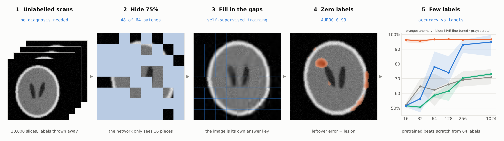
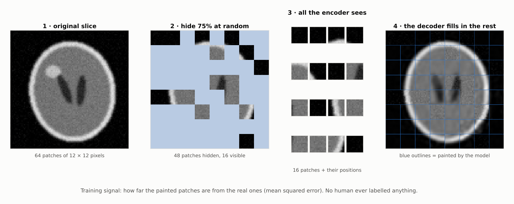
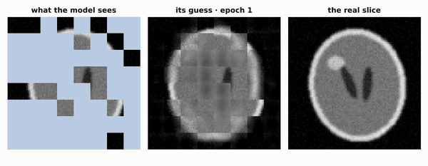
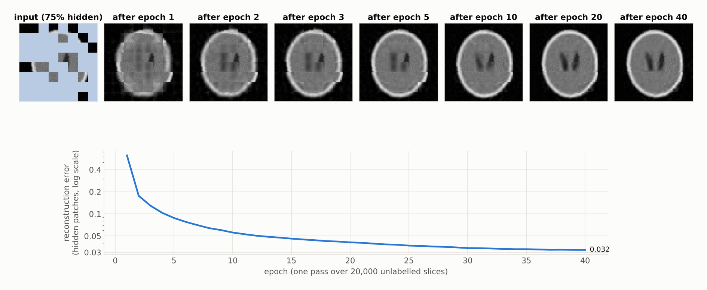
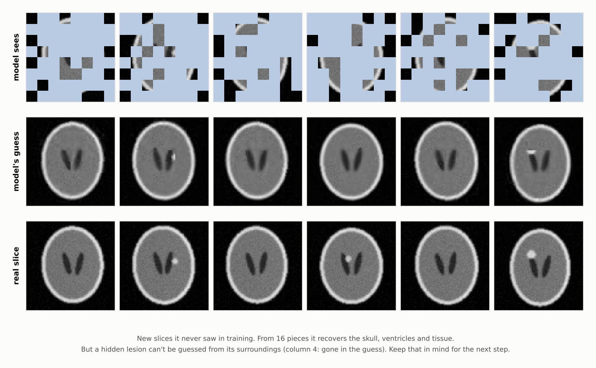
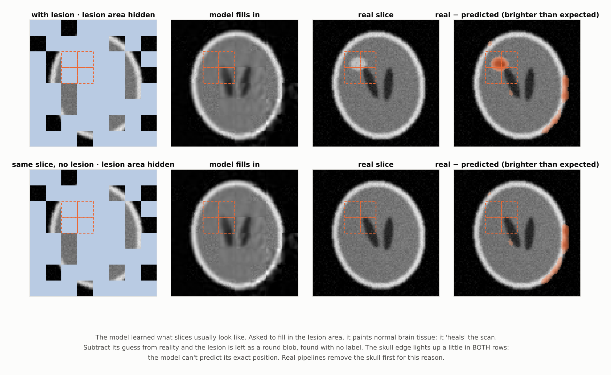
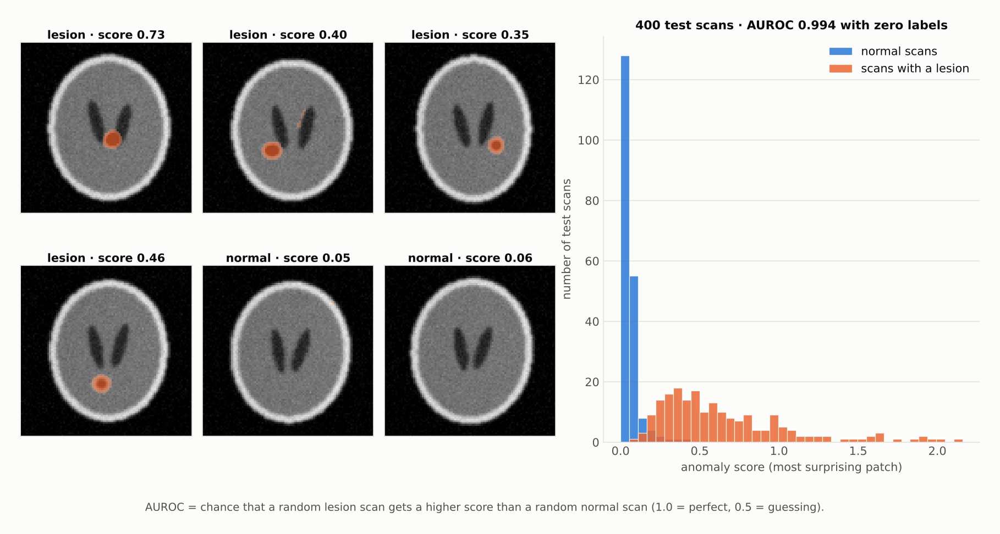
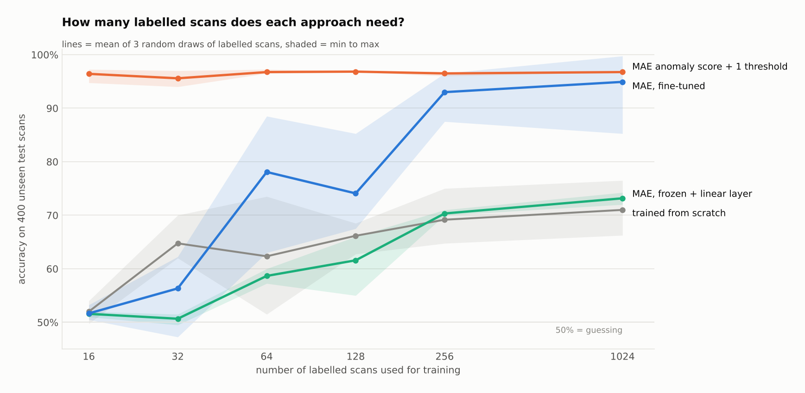

<h1 align="center">How self-supervised learning works</h1>

<p align="center">
  <b>A masked autoencoder learns brain-MRI-style slices from 20,000 unlabelled images,<br>
  then finds lesions with zero labels and beats training from scratch when labels are scarce.</b>
</p>

<p align="center">
  
  
  
  
</p>

<p align="center">
  
</p>

In medical imaging, **scans are plentiful but labels are expensive**: every label needs a radiologist's time.
Self-supervised learning gets around this by making up a training task from the images themselves. Here, the task
is simple: *hide most of the image and paint it back in.* No human labels anything.

This is part 3 of a series that follows the **same synthetic brain slice** through different methods:

| | Repo | What it shows |
|:---:|---|---|
| 1 | [How a CNN works](https://github.com/anupbagale/cnn-one-image) | convolution, pooling, evidence maps |
| 2 | [How a ViT works](https://github.com/anupbagale/how-vit-works) | patches, self-attention, `[CLS]` |
| **3** | **How self-supervised learning works** (this repo) | **learning without labels** |

---

## 1 · The task: hide 75%, paint it back



This is a **masked autoencoder** ([He et al., 2021](https://arxiv.org/abs/2111.06377)):

1. Cut the slice into 64 patches, exactly as in the [ViT repo](https://github.com/anupbagale/how-vit-works).
2. Hide a random 75% of them.
3. An **encoder** (a small ViT) sees only the 16 visible patches.
4. A light **decoder** gets the encoder's output plus 48 empty "mask tokens", and predicts the pixels of every hidden patch.
5. The loss is the squared error on the hidden patches only.

```python
# selfsup/mae.py: the whole training signal
pred, mask = model(img)                              # mask = 1 where a patch was hidden
loss = (((pred - target) ** 2).mean(-1) * mask).sum() / mask.sum()
```

Because 75% is hidden, the model can't just copy neighbouring pixels. It has to learn what a head *looks like*:
the oval skull, the two ventricles, the texture of tissue.

## 2 · Watching it learn

<p align="center">
  
</p>



After 1 epoch it knows "there is a bright ring". By epoch 10 it places the ventricles. The error falls from
0.42 to 0.032 over 40 passes through 20,000 unlabelled slices (about 13 minutes on a laptop CPU).

## 3 · On slices it has never seen



It rebuilds the anatomy from 16 pieces. But look at column 4: the lesion was hidden, and the model's guess has
**no lesion**. A small bright spot can't be predicted from the tissue around it. That sounds like a weakness. It's
actually the key to the next step.

## 4 · The model "heals" the scan, and that finds the lesion



The model has only ever learned what slices *usually* look like. Hide the lesion and it paints normal tissue
there. **Subtract its guess from reality, and what's left is the lesion**: a round blob, found without a single
label. The same slice without a lesion (bottom row) leaves no blob.

To score a whole scan, every patch is predicted from its surroundings (each patch hidden 6 times under different
masks), and the score is the error of the most surprising patch:

```python
# selfsup/anomaly.py
rec    = reconstruct_every_patch(model, img)          # each patch predicted while hidden
excess = ((img - rec).clamp(min=0) / PIXEL_STD) ** 2  # only "brighter than expected" counts
score  = patchify(excess).mean(-1).max(dim=1)         # the most surprising patch
```

> [!NOTE]
> The skull edge also lights up a little, in **both** rows: the model can't predict its exact position. Real
> brain-MRI anomaly-detection pipelines remove the skull first for exactly this reason (the same lesson as step 6
> of the [CNN repo](https://github.com/anupbagale/cnn-one-image)).

## 5 · How well does zero-label detection work?



On 400 test scans the model never saw, the anomaly score separates lesion from normal scans with an
**AUROC of 0.994**, without using any labels. (AUROC is the chance that a random lesion scan scores higher than
a random normal one. 1.0 is perfect, 0.5 is guessing.)

## 6 · When you *do* have a few labels



Four ways to build a lesion classifier, each given 16 to 1,024 labelled scans (3 random draws each):

| Labelled scans | From scratch | MAE, frozen + linear | MAE, fine-tuned | MAE anomaly + 1 threshold |
|:---:|:---:|:---:|:---:|:---:|
| 16 | 52% | 52% | 52% | **96%** |
| 64 | 62% | 59% | **78%** | 97% |
| 256 | 69% | 70% | **93%** | 97% |
| 1,024 | 71% | 73% | **95%** | 97% |

What this shows:

- **Fine-tuning the pretrained encoder beats training from scratch from 64 labels onwards** (93% vs 69% at 256).
  This is the standard reason self-supervised pretraining matters in medicine.
- **With 16–32 labels, fine-tuning doesn't help yet**: both are close to guessing. Too few examples to learn a
  decision, even from good features.
- **The anomaly score needs almost no labels**: the labels only choose one cut-off number.
- **A frozen encoder + linear layer barely beats scratch.** MAE features are known to need fine-tuning, unlike
  contrastive methods. Here they mostly describe anatomy, and a lesion is 1–4 of 64 patches.

---

## Honest notes

- **Synthetic data.** Lesions here are bright round blobs on clean phantoms. Real lesions vary in shape, size and
  contrast, and real scans vary across scanners. Real anomaly detection is much harder than AUROC 0.994 suggests.
- **The anomaly detector only finds "brighter than expected".** It was designed for these lesions; a dark lesion
  would need the other sign.
- **Fixed training budget.** Every classifier gets 500 training steps. The [ViT repo](https://github.com/anupbagale/how-vit-works)
  reaches 99.5% from scratch, but with 6,000 labels and longer training. The comparison here is about *few*
  labels.
- **Fair tuning.** Each method chose its learning rate on a separate validation set, never on the test set.
  The test set is the same 400 scans used in the CNN and ViT repos.
- **High variance with few labels.** The shaded bands show results depend a lot on *which* scans get labelled.

## Run it yourself

```bash
git clone https://github.com/anupbagale/how-self-supervised-learning-works.git
cd how-self-supervised-learning-works
pip install torch --index-url https://download.pytorch.org/whl/cpu
pip install -r requirements.txt

python walkthrough.py    # ~1 min: redraws every figure from the saved weights and results
python -m pytest -q      # masking, loss and shape tests

# optional: redo everything from scratch
python pretrain.py       # ~15 min: self-supervised pretraining, no labels
python evaluate.py       # ~20 min: label-efficiency experiment
```

## Repository layout

```
how-self-supervised-learning-works/
├── selfsup/
│   ├── mae.py          masked autoencoder: patchify, random masking, encoder, decoder, loss
│   ├── anomaly.py      zero-label lesion detection from reconstruction error
│   └── phantom.py      synthetic brain-MRI-like slices (shared with the CNN and ViT repos)
├── pretrain.py         step 1: self-supervised pretraining on 20,000 unlabelled slices
├── evaluate.py         step 2: label-efficiency experiment + anomaly AUROC
├── walkthrough.py      step 3: draws every figure
├── weights/mae.pt      pretrained weights (0.5 MB)
├── results/            CSV results behind every number in this README
├── tests/test_mae.py
└── assets/             figures and animation
```

## Further reading

- He et al., [*Masked Autoencoders Are Scalable Vision Learners*](https://arxiv.org/abs/2111.06377), 2021
- Baur et al., [*Autoencoders for unsupervised anomaly segmentation in brain MR images: a comparative study*](https://arxiv.org/abs/2004.03271), 2020

## License

MIT, see [LICENSE](LICENSE).
